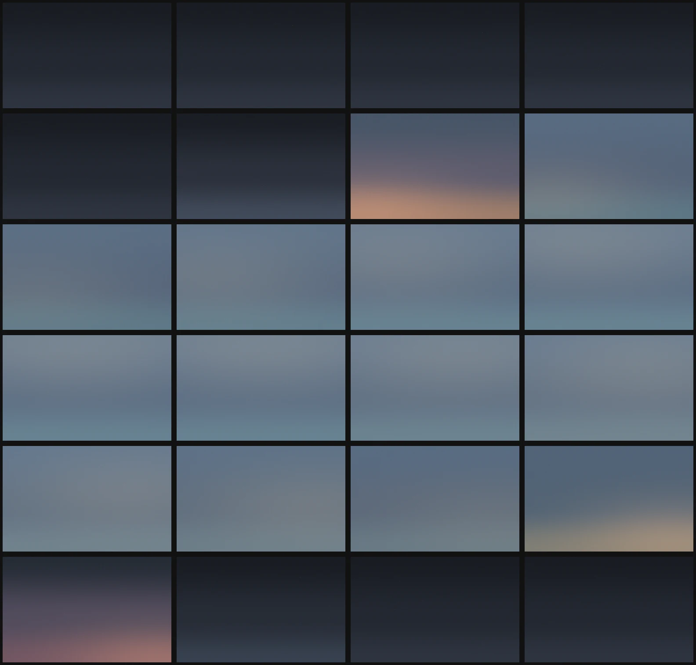
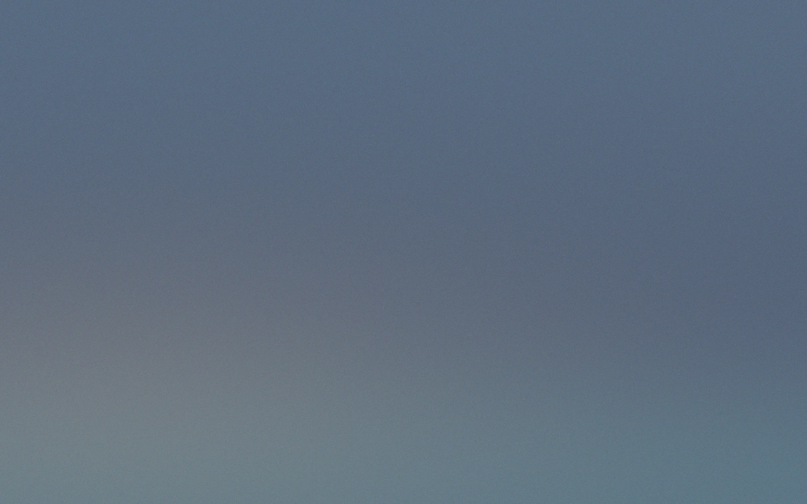
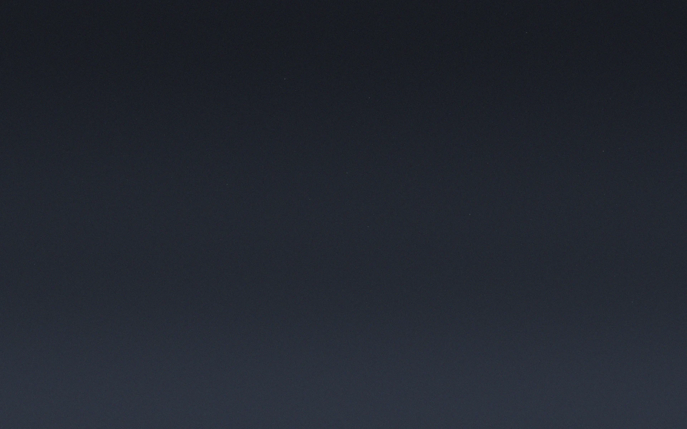

# skybg



**Theme-aware sky backgrounds that follow the sun and local weather on Omarchy.**

`skybg` renders a quiet gradient from the active Omarchy theme, the sun's
elevation and azimuth, and current cloud cover. A soft glow crosses the screen
from east to west, the horizon warming under the sun and holding the mauve of
the Earth's shadow opposite it; cloud and fog flatten the sky; clear nights
reveal the real sky — the Yale Bright Star Catalogue and the Milky Way,
projected for your location and the hour, turning with sidereal time.

It is built for Omarchy Quattro. Change themes and the sky retints itself.
Choose another background and `skybg` bows out after confirming the change.
It also runs on macOS, where it follows the system light/dark appearance.

| Sunrise | Clear night |
| --- | --- |
|  |  |

## Requirements

- Python 3.11 or newer
- ImageMagick (`magick` and `montage`)
- On Omarchy: Omarchy Quattro and systemd user services
- On macOS: nothing extra — the installer sets up a launchd agent, and macOS
  will ask once to allow your terminal to control "System Events"
- Optional: [linecast](https://github.com/ashuttl/linecast) for automatic location
- Optional: network access for Open-Meteo cloud and fog data

## Install

```sh
git clone https://github.com/ashuttl/skybg.git
cd skybg
./install.sh
```

The installer copies only user-owned files and does not start the timer. Set a
location explicitly, or use `auto` when `linecast location` is configured:

```sh
skybg config location 43.677 -70.371
# or
skybg config location auto

skybg doctor
skybg preview
skybg on
```

## Commands

```text
skybg on                 Set the background and start the five-minute timer
skybg off                Stop the timer; leave the current background alone
skybg once               Render and set one background
skybg tick               Quiet timer entry point
skybg status             Show the sky and runtime state
skybg doctor             Check dependencies and integration
skybg preview [0..100]   Render a 24-hour montage; optionally fix cloud cover
skybg config show
skybg config location LAT LON
skybg config location auto
skybg config weather on|off
skybg config style sky|daylight|bokashi|cyanotype|gradient|window|slitscan
```

Configuration lives at `${XDG_CONFIG_HOME:-~/.config}/skybg/config.json`.
Generated images, cached location and weather, and the render lock live under
`${XDG_STATE_HOME:-~/.local/state}/skybg/`.

## Styles

`sky`, the default, is everything described above: theme colors, the sun's
glow crossing the screen, weather, stars and the Milky Way.

`daylight` is a port of the Daylight wallpaper from
[Pond](https://github.com/bflycomputer/pond-interface): a calm six-band
gradient from a fixed palette of twelve moments in the day, blended in Oklab.
It does not use the theme or the weather and makes no network requests. Where
Pond assumes sunrise at 6:30 and sunset at 18:30, `skybg` paces the palette by
the real sunrise and sunset at your location.

`bokashi` is a sky the way a woodblock print makes one, after the printer's
wiped gradation of the same name: a deep band of ink along the top edge, a
flat ground, and a band of colour rising from the horizon — pink at dawn, red
at dusk. A flat red sun sits where the sun is from your location, low all day
in winter and high in summer, and sinks into the horizon band; the moon
follows in its real phase, its lit side leaning toward the sun. The theme
chooses the stock — natural paper under a light theme, indigo-dyed under a
dark one — and tints the inks: each keeps the lightness it was printed with
and takes its hue from the theme's blue, red, yellow or magenta, and the
sheet itself sits on the theme's background. It does not use the weather.

`cyanotype` charts the sky instead of painting it — a sun print of the sun,
white on Prussian blue. The whole compass is unrolled across the screen and
the horizon ruled through it. Today's path of the sun is a wave over and under
that line, a dot for each hour, solid where the sun has been and dotted where
it has yet to go; the sun rides it as a disc by day and a ring by night, and
the moon keeps its place and phase. Behind, faintly, are the paths of the
solstices and the equinox: the most and the least the sun ever does where you
are — a tall narrow wave near the poles, a wall near the equator. The blue
deepens from day to night, with the three twilights as a wash under the
horizon. The blue is the theme's blue, the sheet deepens to the theme's
background at night, and the line is its foreground; a light theme turns it
into blue line on paper the colour of its background. It does not use the
weather.

`gradient` is a plain gradient that knows where the sun is. It does not
picture the sky; it is light falling away from a source, and the source stands
far off the screen in the sun's direction. So the gradient turns once a day,
like the shadow on a sundial: lit from the left at sunrise, from overhead at
noon, from the right at sunset, and from below through the night. Its colours
run from the colour of the light to the colour of what the light has not
reached — cream into blue at midday, gold through magenta into violet at
dusk, pinker and cooler at dawn — blended in Oklab so the middle never goes
muddy. The colours are its own, tinted by the theme like bokashi's inks. It
does not use the weather.

`window` leaves the sky out and shows what it does indoors: a bare room, seen
from where its window wall would be, looking at the wall the window faces. The
window faces the sun's side of the sky, and the sun throws its panes into the
room as it really would, each point of the room looking back along the light
to see whether glass or glazing bar is in the way. So the shapes are the true
ones: upright on the far wall when the sun is low, sliding down it and folding
out across the floor as the sun climbs, sheared along a side wall early and
late — on the far wall for most of a December day, a bright strip of floor
under the window in June. Light that only grazes a surface lies on it thinly;
edges blur with the length of the ray; the sky's grey comes in through the
same window and falls away into the corners; and what the sun lights lights
the rest of the room in turn, in its own colour, white at noon and red at
sunset. Cloud softens the panes and then puts them out, leaving the grey
light of the window itself; fog does the same. At night the moon throws its
own, faintly, by its phase. One liberty is taken: light from far round to the
side is turned back toward the room, or a summer sunrise, which comes from
behind the window's wall, would not come in at all. The theme tints the light
and sets the room: under a dark theme the room at night is its background,
under a light one the wall in full sun is.
floor in full sun is.

`slitscan` is the whole day in one picture, the way a slit-scan camera makes
one: every column of the screen is the sky at a different moment. Now is the
middle column, the twelve hours gone run out to the left edge and the twelve
to come to the right, so the night is as wide as the night is long and each
twilight is a seam between them. The picture slides left as the day goes.
Each column is the `sky` style's clear sky for its moment, in the theme's
colours. It does not use the weather.

```sh
skybg config style bokashi     # or cyanotype, gradient, window, slitscan
skybg preview
skybg once
```

## Location, weather, and privacy

In automatic mode, `skybg` asks `linecast location` for coordinates and caches
the result. It never guesses a location. Without linecast or an explicit
location, it stops with setup instructions.

Weather mode (the `sky` and `window` styles) sends latitude and longitude to the
[Open-Meteo forecast API](https://open-meteo.com/) to request current cloud
cover and weather code. Results are cached for 20 minutes. If the request
fails, `skybg` uses the last result, then a mild 30% cloud fallback. Disable
all weather requests with:

```sh
skybg config weather off
```

Solar position, the stars and the Milky Way are calculated locally. The star
catalogue and the Milky Way raster are bundled (see `data/SOURCES.md` for their
sources and licences) and are never fetched at run time.

## Omarchy integration

`skybg` uses `omarchy theme bg set` to change the live background. A supported
`theme-set` hook rerenders while its timer is active, so every theme supplies
its own palette. Each render takes a different name from the last two —
`sky-0.png`, `sky-1.png`, `sky-2.png` in turn — because Quattro watches the
background symlink target.

## macOS integration

On macOS, the timer is a launchd agent (`com.skybg.tick`, every five minutes)
that runs the `python3` the installer found — launchd's own `PATH` reaches only
the system's Python 3.9, so rerun `./install.sh` if you change Pythons. The
display size comes from `system_profiler`, and the wallpaper is set
through System Events — which covers every display in the current Space.
macOS remembers every image file it is ever given as a wallpaper and rechecks
them all on each change, so `skybg` reuses a few file names rather than making
a new one each time, skipping any name that another Space still shows.
Without an Omarchy theme, colors come from a built-in palette that follows the
system light/dark appearance and retints within one tick of a switch. To use
your own palette instead, drop an Omarchy-style `colors.toml` at
`${XDG_CONFIG_HOME:-~/.config}/skybg/colors.toml`.

## Updating and removing

Pull a new tagged release and rerun `./install.sh`; installation is idempotent.

```sh
./uninstall.sh          # retain config and generated state
./uninstall.sh --purge  # remove those too
```

Uninstalling never changes the current background.

## License

MIT. See [LICENSE](LICENSE). The `daylight` style's palette and interpolation
are ported from Pond's `pond-wallpaper`, © 2026 Butterfly Interaction Inc.,
under the BSD 3-Clause license in
[LICENSES/pond-wallpaper.txt](LICENSES/pond-wallpaper.txt).
